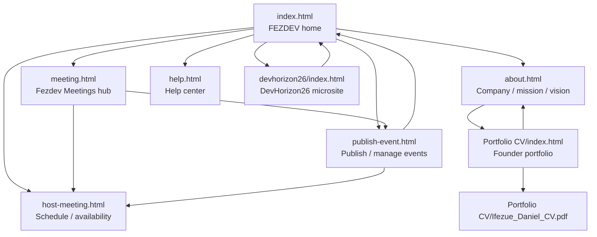
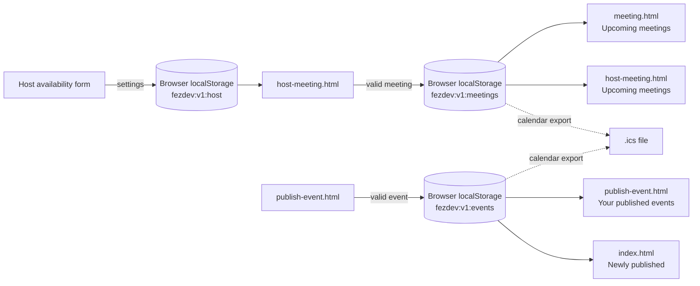

# FEZDEV Project Flow

## Architecture

This is a static, multi-page HTML prototype. Pages connect through ordinary relative links; there is no client-side router, build step, or shared server. The browser loads each HTML file directly.

The root product pages share `fezdev.css` and `fezdev.js`. Navigation markup is repeated in each page, so a global navigation change may need to be applied to each HTML file.

## File Connection Tree

```text
FEZDEV/
+-- index.html                 +-- uses fezdev.css
|                             +-- uses fezdev.js
|   +-- links to meeting.html, host-meeting.html, publish-event.html
|   +-- links to about.html and help.html
|   +-- links to devhorizon26/index.html
+-- meeting.html               +-- uses fezdev.css and fezdev.js
|   +-- links to host-meeting.html and publish-event.html
+-- host-meeting.html          +-- uses fezdev.css and fezdev.js
|   +-- reads/writes meetings and availability in browser storage
+-- publish-event.html         +-- uses fezdev.css and fezdev.js
|   +-- reads/writes events in browser storage
+-- about.html                 +-- uses fezdev.css and fezdev.js
|   +-- links to Portfolio CV/index.html
+-- help.html                  +-- uses fezdev.css and fezdev.js
+-- devhorizon26/
|   +-- index.html              +-- uses ../fezdev.css and ../fezdev.js
|                              +-- links back to root pages
+-- fezdev.css                 +-- shared styles for root pages and DevHorizon26
+-- fezdev.js                  +-- menu, forms, local storage, lists, and calendar files
+-- Portfolio CV/
|   +-- index.html              +-- uses style.css and images/profile.jpg.jpeg
|   |                          +-- links to Ifezue_Daniel_CV.pdf
|   |                          +-- links back to ../about.html
|   +-- style.css
|   +-- images/profile.jpg.jpeg
|   +-- Ifezue_Daniel_CV.pdf
|   +-- Enhance/enhance.js      (optional; not loaded)
|   +-- .vscode/settings.json
+-- js/                         (empty)
+-- PROJECT_FLOW.md             (this guide)
```

## Page and File Map

| File | Purpose | Connections |
| --- | --- | --- |
| `index.html` | FEZDEV home; featured and locally published events; meeting entry points | Links to About, Help, `meeting.html`, `host-meeting.html`, `publish-event.html`, and `devhorizon26/index.html` |
| `meeting.html` | Fezdev Meetings hub; participant entry and upcoming meetings | Links to `host-meeting.html` and `publish-event.html` |
| `host-meeting.html` | Schedule meetings and configure host availability | Saves meetings and availability through `fezdev.js`; links back to `meeting.html` |
| `publish-event.html` | Create and manage events | Saves events through `fezdev.js`; links back to the homepage |
| `about.html` | FEZDEV company and product overview, mission, vision, founder profile | Links to `Portfolio CV/index.html` |
| `help.html` | Product and workflow help | Links to the event publisher and page sections |
| `devhorizon26/index.html` | DevHorizon26 event microsite | Uses the shared root stylesheet and script via `../fezdev.css` and `../fezdev.js` |
| `fezdev.css` | Shared visual styles for the FEZDEV pages and DevHorizon26 | Loaded by the root product pages and DevHorizon26 |
| `fezdev.js` | Shared menu, validation, time zones, browser storage, event/meeting lists, confirmations, and calendar exports | Loaded by the root product pages and DevHorizon26 |
| `Portfolio CV/index.html` | Independent founder portfolio page | Uses its own `style.css`, profile image, and CV PDF; links back to `../about.html` |
| `Portfolio CV/style.css` | Portfolio-specific visual styles | Loaded only by the Portfolio CV page |
| `Portfolio CV/images/profile.jpg.jpeg` | Portfolio profile image | Displayed by `Portfolio CV/index.html` |
| `Portfolio CV/Ifezue_Daniel_CV.pdf` | Original downloadable/viewable CV | Linked by `Portfolio CV/index.html` |

`js/` is currently empty. `Portfolio CV/Enhance/enhance.js` is optional and is not loaded by the portfolio page.

## Navigation Flow



## Application Data Flow



## Important Runtime Behavior

- Meeting, event, and availability data are stored in the current browser. They are not synchronized to a backend or other visitors' devices.
- Publishing an event validates the required event details, stores the event locally, refreshes the local event lists, and shows a confirmation. A calendar file can then be downloaded from the confirmation or an event listing.
- Scheduling a meeting stores it locally and downloads a calendar file. Email invitations and automatic Google Meet/Zoom room creation are not implemented.
- `fezdev.js` emits a `fezdev:data` browser event after storage changes; the page lists listen for it and rerender.
